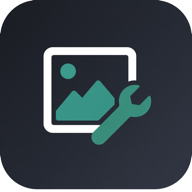
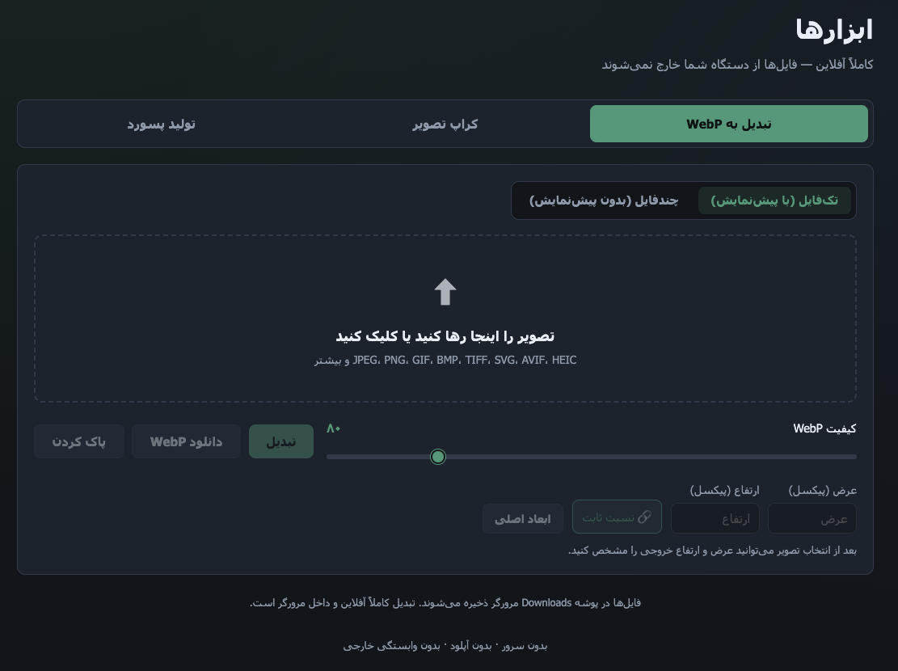
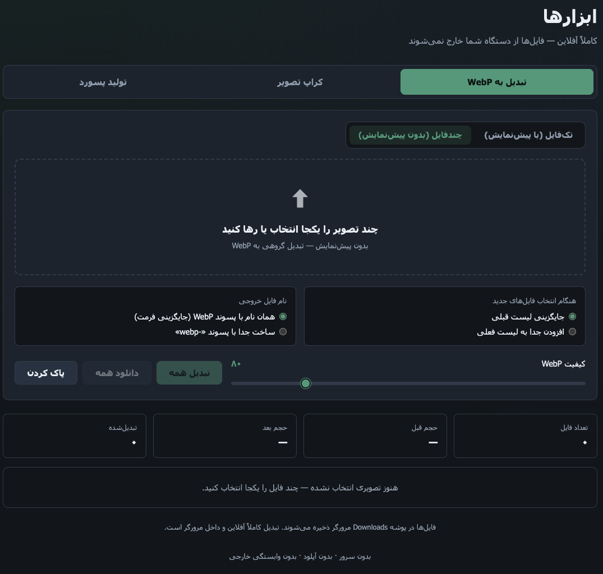
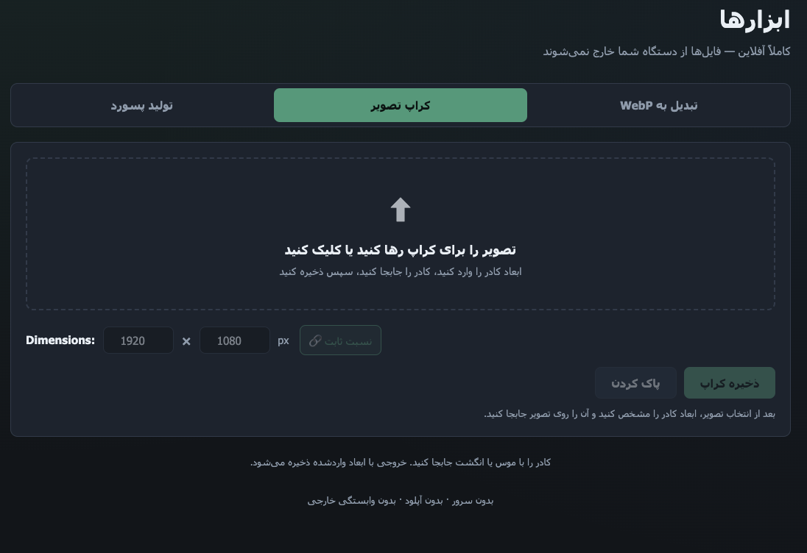
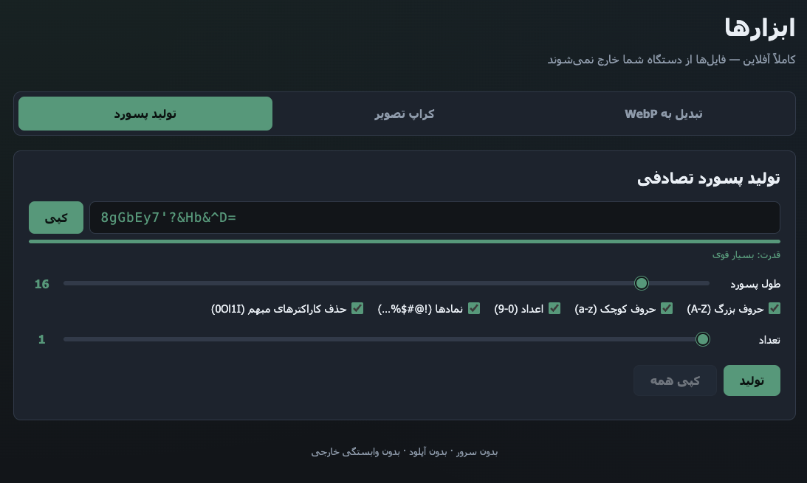

# n4n-tools — Offline Web Tools

<p align="center">
  
</p>

<p align="center">
  <strong>تبدیل WebP · کراپ تصویر · تولید پسورد</strong><br />
  کاملاً آفلاین در مرورگر — بدون سرور، بدون آپلود، بدون وابستگی خارجی
</p>

<p align="center">
  
  
  
</p>

---

## درباره پروژه

یک صفحهٔ HTML خالص برای کارهای روزمره روی تصویر و پسورد. همهٔ پردازش‌ها داخل مرورگر انجام می‌شود و فایل‌ها از دستگاه خارج نمی‌شوند.

| ابزار | قابلیت‌ها |
| --- | --- |
| **تبدیل به WebP** | تک‌فایل با پیش‌نمایش، چندفایل بدون پیش‌نمایش، کیفیت قابل تنظیم، تغییر ابعاد، دانلود تکی/گروهی |
| **کراپ تصویر** | انتخاب ابعاد خروجی، قفل نسبت، جابجایی کادر، ذخیره |
| **تولید پسورد** | طول و تعداد دلخواه، حروف/عدد/نماد، حذف مبهم‌ها، سنجش قدرت |

## اسکرین‌شات‌ها

### تبدیل WebP — تک‌فایل


### تبدیل WebP — چندفایل


### کراپ تصویر


### تولید پسورد


## اجرا

نیازی به نصب پکیج نیست. یکی از این‌ها کافی است:

```bash
# باز کردن مستقیم
open index.html

# یا سرو محلی
python3 -m http.server 8080
# سپس http://127.0.0.1:8080
```

## ساختار

```text
.
├── index.html              # نقطه ورود (GitHub Pages)
├── manifest.webmanifest    # PWA سبک
├── LICENSE
├── README.md
├── assets/
│   ├── favicon.svg
│   ├── favicon-32.png
│   ├── apple-touch-icon.png
│   ├── icon-192.png
│   ├── icon-512.png
│   └── og-cover.png
└── docs/
    ├── screenshot-webp.png
    ├── screenshot-batch.png
    ├── screenshot-crop.png
    └── screenshot-password.png
```

## حریم خصوصی

- هیچ درخواستی به سرور ارسال نمی‌شود
- تصویر و پسورد فقط در حافظهٔ مرورگر پردازش می‌شوند
- مناسب برای استفادهٔ محلی و آفلاین

## مجوز

[MIT](LICENSE)
